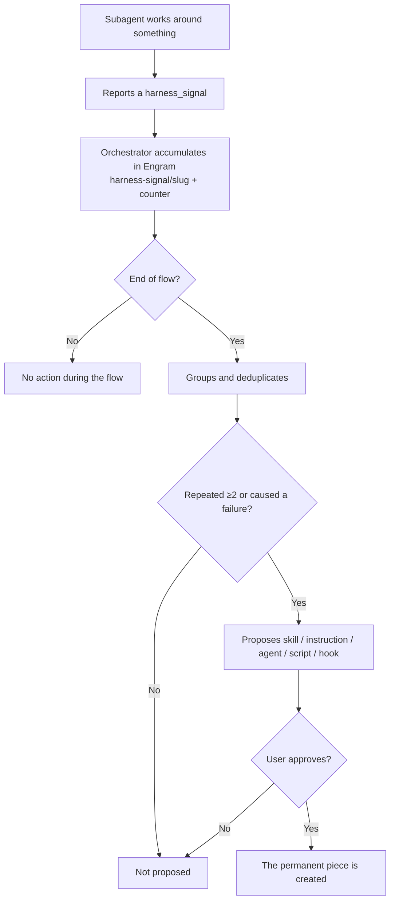

# Self-learning: harness signals

> The differentiator of the model. SddOrch does not just run: it **learns from
> its own friction** and proposes permanent improvements.

## The concept

A **harness** is the set of pieces that give an agent its capabilities:
skills, instructions, subagents, scripts, and hooks. During a run, a subagent
may find that something that *should* exist **does not**, and has to work
around it. That is a signal.

Instead of losing that information, every subagent can report a
`harness_signal`: a concrete friction that deserves to become a permanent
piece.

Examples:

- You repeated a procedure that deserves a **skill**.
- An **instruction** was missing and you had to infer it.
- A task would have gone better with a specialized **agent**.
- You automated something with ad-hoc commands that deserves a **script**.
- A command needed an adjustment that would fit as a **hook**.
- While researching on the web, a page tried to give you instructions (it is
  ignored and reported as a signal).

## Signal format

It travels inside every subagent's response contract:

```yaml
harness_signals:
  - type: skill | instruction | agent | script | command-hook
    trigger: <situation that caused it>
    workaround: <what you did to get around it>
    evidence: <concrete file, error, or command>
    reuse: <where or how often it would happen again>
```

Rules:

- Only **harness gaps** are reported, not style preferences or product-code
  issues.
- The subagent **does not create** the skill, instruction, or script: it only
  reports it.

## The loop

```text
1. Subagent works around something and reports the signal
        │
        ▼
2. The orchestrator accumulates it in persistent memory
   (same key → updates a counter, no duplication)
        │
        ▼
3. During the flow it does NOT act on the signals
        │
        ▼
4. At the end: it groups, deduplicates, and PROPOSES
   only those repeated ≥2 times or that caused a failure/retry
        │
        ▼
5. The user approves or rejects the creation
```

**The same loop as a diagram (Mermaid):**



Fine points:

- **During the flow, the harness is not fixed.** Doing so mid-run would
  introduce uncontrolled variables. First the work is finished; then the tool
  is improved.
- **It only proposes; it never creates without approval.** Self-learning is
  assisted, not blindly autonomous.
- **Repetition filter.** A one-off annoyance does not justify a new piece; a
  pattern that repeats or that broke something does.

## Why it matters

- **Turns friction into infrastructure.** What is a *workaround* today becomes a
  skill that all future flows inherit.
- **The harness sharpens with use.** The more the method is used, the less
  residual friction remains: it is a continuous-improvement loop, not a static
  setup.
- **Evidence, not opinion.** Every proposal arrives with trigger, evidence, and
  frequency, so the decision to create it is informed.
- **Low noise.** Because signals are filtered by repetition and impact, the
  user does not receive an endless list of suggestions.

## Tuning the step budget

Each agent's frontmatter (`.opencode/agents/<agent>.md`) defines `steps`: the
step ceiling it can use before being cut off. It is not a minor configuration
detail: a short ceiling leaves work half-done and forces sessions to be resumed.

When a subagent exhausts `steps` **before finishing** —unable to save its report
to Engram, unable to close its tasks, or with commits still pending— it reports
it as an `agent` signal. The orchestrator accumulates it and, at the end,
proposes one of two ways out:

1. **Raise the budget** for the agent in its frontmatter.
2. **Split the work** into smaller units (same ceiling, less work per unit).

A real case from this repository (the `step-limits` signal: ≥6 repetitions and
several failures): researchers used up 25 steps without managing to write to
Engram, the implementer used up 40 on large tasks, and release was left with
pending commits. Values applied:

| Agent | Before | After |
|---|---|---|
| `sddorch-researcher-code` / `-market` | 25 | 40 |
| `sddorch-writer` | 20 | 30 |
| `sddorch-implementer` | 40 | 60 |
| `sddorch-release` | 25 | 50 |
| `sddorch-reviewer` | 25 | 40 |
| `sddorch-tester` | 40 | 60 |

`reviewer` and `tester` were raised **for consistency** with the rest of the
split (there was no evidence of them running out): a budget that falls short at
the constitution gate or in the tests ends up costing another resume.

`release` ended up **one notch above** the rest, not because of workload but
because of **mixed state**: being cut halfway through the commits leaves a
half-done history (the real failure was 7/12 commits), and that is worse than
never having started.

### Recurrence: split the researcher's scope

The `step-limits` signal came back for the researchers with the 40 steps already
applied: the problem was not the ceiling but a scope that was too large (plan +
test map + two contracts in a single investigation). The fix was **not** to
raise `steps` again, but:

- **One researcher, one artifact or role**, with a closed list of files or
  questions (if the scope covers more, the orchestrator splits it into several
  researchers with a suffixed `topic_key`, `findings/<role>-<part>`).
- **Incremental saving:** the researcher saves a draft to Engram around the
  middle of its budget (upsert on the same `topic_key`); if it is cut off, the
  partial report is not lost and is resumed only for what is missing.
- **Measurements against the OpenCode store** (`~/.local/share/opencode`): the
  code researcher reads it in **read-only** mode (`sqlite3 -readonly`). If the
  measurement exceeds its budget, the orchestrator launches a `general` with
  `shell`, stores the result under `.opencode/runs/<run>/` and hands it over as
  data.

### The other half: closing before the cut

Raising the ceiling reduces the chance of a cut, but does not remove it. The
contract (`sddorch-contract.md`) covers the rest: when a subagent sees it is
running short, it **persists what it has and closes with `BLOCKED`** including
what was done and what remains, instead of running out of steps. That way a cut
stops being a silent loss —the report that was never saved, the empty final
answer— and becomes a notice the orchestrator can read, report, and act on.

`steps` is a **ceiling, not a spend**: raising it does not make a run that
finishes on its own more expensive, because the agent hands control back when
done. What *is* expensive —in time and in context— is **resuming** a
half-finished session.

## Signal → artifact examples

| Observed signal | Proposed artifact |
|---|---|
| The same test pattern repeats in every feature | `test-generator` skill |
| The commit format is always inferred | `commit-conventions` skill |
| A command needed the same post-step | Hook in `.specify/extensions.yml` |
| An analysis is always done the same way before implementing | `sddorch-researcher-code` subagent |
| A discipline profile for discovery was missing | `.opencode/roles/<role>.md` file |
| The PR format has to be remembered | `pr-detail` skill |
| A subagent exhausts its step budget before finishing | Raise the agent's `steps` (`.opencode/agents/<agent>.md`) or split the task into units |

> In practice, many of the skills and subagents in this project were born from
> this very loop: they are the result of detecting friction and turning it into
> a permanent piece.
