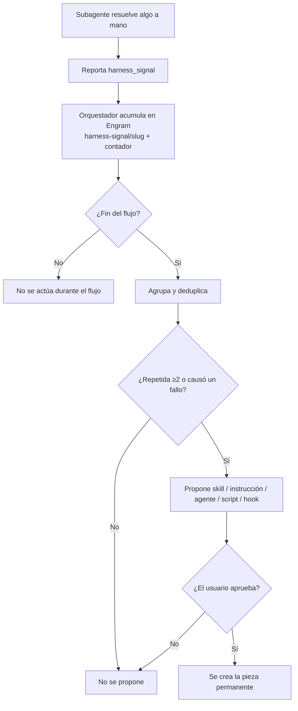

# Auto-aprendizaje: señales de harness

> El diferencial del modelo. SddOrch no solo ejecuta: **aprende de su propia
> fricción** y propone mejoras permanentes.

## El concepto

Un **harness** es el conjunto de piezas que le dan capacidades al agente:
skills, instrucciones, subagentes, scripts y hooks. Durante una ejecución, un
subagente puede encontrarse con que algo que debería existir **no existe** y
tiene que resolverlo a mano. Eso es una señal.

En lugar de perder esa información, cada subagente puede reportar una
`harness_signal`: una fricción concreta que merece convertirse en una pieza
permanente.

Ejemplos:

- Repetiste un procedimiento que merece una **skill**.
- Faltaba una **instrucción** y tuviste que inferirla.
- Una tarea habría ido mejor con un **agente** especializado.
- Automatizaste algo con comandos sueltos que merece un **script**.
- Un comando necesitó un ajuste que encajaría como **hook**.
- Investigando en la web, una página intentó darte instrucciones (se ignora y se
  reporta como señal).

## Formato de la señal

Viaja dentro del contrato de retorno de todo subagente:

```yaml
harness_signals:
  - type: skill | instruction | agent | script | command-hook
    trigger: <situación que lo provocó>
    workaround: <qué hiciste para salir del paso>
    evidence: <archivo, error o comando concreto>
    reuse: <dónde o con qué frecuencia volvería a pasar>
```

Reglas:

- Solo se reportan **huecos del harness**, no preferencias de estilo ni
  problemas del código del producto.
- El subagente **no crea** la skill, la instrucción ni el script: solo lo
  reporta.

## El ciclo

```text
1. Subagente resuelve algo a mano y reporta la señal
        │
        ▼
2. El orquestador la acumula en memoria persistente
   (misma clave → actualiza contador, no duplica)
        │
        ▼
3. Durante el flujo NO se actúa sobre las señales
        │
        ▼
4. Al cerrar: agrupa, deduplica y PROPONE
   solo las repetidas ≥2 veces o las que causaron fallo/reintento
        │
        ▼
5. El usuario aprueba o rechaza la creación
```

**El mismo ciclo como diagrama (Mermaid):**



Puntos finos:

- **Durante el flujo, no se corrige el harness.** Hacerlo a mitad de una
  ejecución introduciría variables no controladas. Primero se termina el
  trabajo; después se mejora la herramienta.
- **Solo propone; nunca crea sin aprobación.** El auto-aprendizaje es
  asistido, no autónomo a ciegas.
- **Filtro por repetición.** Una molestia de una sola vez no justifica una
  pieza nueva; un patrón que se repite o que rompió algo, sí.

## Por qué importa

- **Convierte fricción en infraestructura.** Lo que hoy es un *workaround*,
  mañana es una skill que todos los flujos heredan.
- **El harness se afila con el uso.** Cuanto más se usa el método, menos
  fricción residual queda: es un ciclo de mejora continua, no un setup
  estático.
- **Evidencia, no opinión.** Cada propuesta llega con disparador, evidencia y
  frecuencia, así que la decisión de crearla es informada.
- **Bajo ruido.** Como se filtran por repetición y por impacto, el usuario no
  recibe una lista infinita de sugerencias.

## Ajustar el presupuesto de pasos

El frontmatter de cada agente (`.opencode/agents/<agente>.md`) define `steps`:
el techo de pasos que puede dar antes de ser cortado. No es un detalle menor de
configuración: un techo corto deja trabajo a medias y obliga a reanudar
sesiones.

Cuando un subagente agota `steps` **antes de terminar** —sin poder guardar su
informe en Engram, sin cerrar sus tareas o con commits pendientes— lo reporta
como señal de tipo `agent`. El orquestador la acumula y, al cerrar, propone una
de dos salidas:

1. **Subir el presupuesto** del agente en su frontmatter.
2. **Partir el trabajo** en unidades más pequeñas (mismo techo, menos trabajo
   por unidad).

Caso real de este repositorio (señal `step-limits`: ≥6 repeticiones y varios
fallos): los researchers agotaban 25 pasos sin llegar a escribir en Engram, el
implementer agotaba 40 en tareas grandes y el release quedaba con commits sin
hacer. Valores aplicados:

| Agente | Antes | Después |
|---|---|---|
| `sddorch-researcher-code` / `-market` | 25 | 40 |
| `sddorch-writer` | 20 | 30 |
| `sddorch-implementer` | 40 | 60 |
| `sddorch-release` | 25 | 50 |
| `sddorch-reviewer` | 25 | 40 |
| `sddorch-tester` | 40 | 60 |

`reviewer` y `tester` subieron **por coherencia** con el resto del reparto (no
había evidencia de agotamiento en ellos): un presupuesto que se queda corto en
la compuerta de constitución o en los tests vuelve a costar una reanudación.

`release` quedó **un escalón por encima** del resto, y no por volumen de trabajo
sino por **estado mezclado**: cortarse a mitad de los commits deja un historial
a medias (el fallo real fue 7/12 commits), y eso es peor que no haber empezado.

### Reincidencia: partir el alcance del researcher

La señal `step-limits` reapareció en los researchers con los 40 pasos ya
aplicados: el problema no era el techo sino un alcance demasiado grande (plan +
mapa de tests + dos contratos en una sola investigación). La corrección **no**
fue subir otra vez `steps`, sino:

- **Un researcher, un artefacto o rol**, con una lista cerrada de archivos o
  preguntas (si el alcance abarca más, el orquestador lo divide en varios
  researchers con `topic_key` sufijado, `findings/<rol>-<parte>`).
- **Guardado incremental:** el researcher guarda un borrador en Engram hacia la
  mitad de su presupuesto (upsert en la misma `topic_key`); si lo cortan, el
  informe parcial no se pierde y se reanuda solo para lo que falta.
- **Mediciones del store de OpenCode** (`~/.local/share/opencode`): el
  researcher de código lo lee en **solo lectura** (`sqlite3 -readonly`). Si la
  medición excede su presupuesto, el orquestador lanza un `general` con `shell`,
  guarda el resultado en `.opencode/runs/<run>/` y se lo pasa como dato.

### La otra mitad: cerrar antes del corte

Subir el techo reduce la probabilidad de corte, pero no la elimina. El contrato
(`sddorch-contract.md`) cubre el resto: cuando un subagente se ve corto, **persiste
lo que tenga y cierra con `BLOCKED`** incluyendo lo hecho y lo que falta, en
lugar de quedarse sin pasos. Así el corte deja de ser una pérdida silenciosa —el
informe que nunca se guardó, el final vacío— y pasa a ser un aviso que el
orquestador puede leer, reportar y accionar.

`steps` es un **techo, no un gasto**: subirlo no encarece una ejecución que
termina sola, porque el agente devuelve el control al acabar. Lo que sí
encarece —en tiempo y en contexto— es **reanudar** una sesión cortada a medias.

## Ejemplos de señal → artefacto

| Señal observada | Artefacto propuesto |
|---|---|
| El mismo patrón de test se repite en cada feature | Skill `test-generator` |
| Se infiere siempre el formato de commit | Skill `commit-conventions` |
| Un comando necesitó el mismo post-paso | Hook en `.specify/extensions.yml` |
| Un análisis se hace siempre igual antes de implementar | Subagente `sddorch-researcher-code` |
| Faltaba un perfil de disciplina para el descubrimiento | Archivo `.opencode/roles/<rol>.md` |
| Hay que recordar el formato del PR | Skill `pr-detail` |
| Un subagente agota su presupuesto de pasos antes de terminar | Subir `steps` del agente (`.opencode/agents/<agente>.md`) o partir la tarea en unidades |

> Buena parte de las skills y subagentes de este proyecto nacieron, en la
> práctica, de este mismo ciclo: son el resultado de detectar fricción y
> convertirla en pieza permanente.
